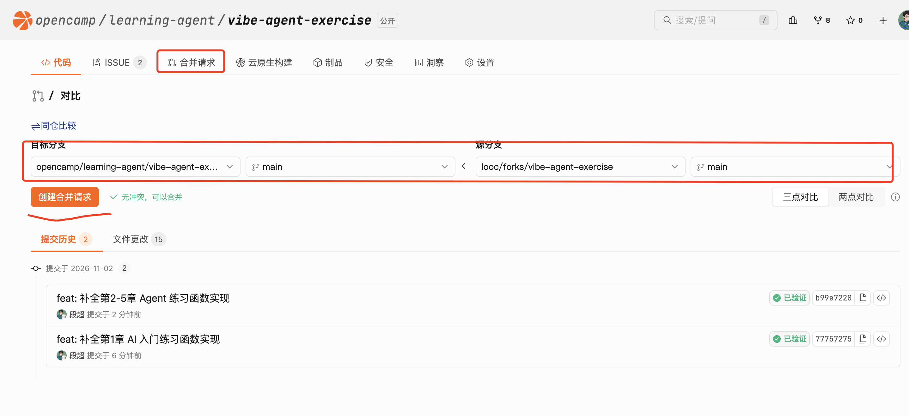
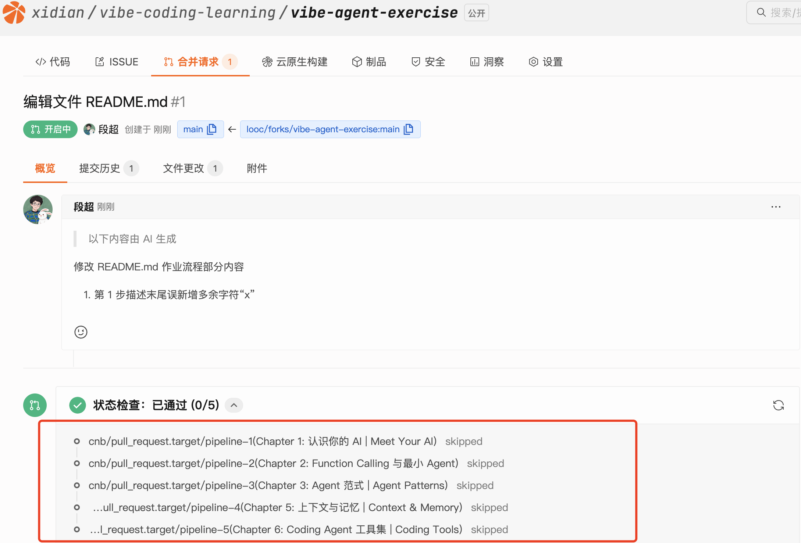

# Vibe Agent Course · 配套作业

本仓库是 [**Vibe Agent Course**](https://cnb.cool/xidian/vibe-coding-learning/vibe-agent-course) 教程的配套作业。提交 PR 后由 CI 自动测评。

## 作业流程

1. **Fork** 本仓库到你的账号下
2. 按章节完成作业（见下方两部分）
3. 向本仓库 **提交 PR**，CI 流水线（`.cnb.yml`）会自动运行测试并给出测评结果
4. 全部通过即视为完成

> **注意**：同一个仓库的同一个分支只能存在一个 PR。如果后续想修改作业，直接在自己的仓库对应分支上持续修改并提交代码即可，**无需再新建 PR**，原来的 PR 会自动重新跑最新的代码。

提交 PR 示意（由于有 AI 自动生成提交信息的环节，创建/合并按钮需要点击两次）：



PR 详情与测评结果：



## 仓库结构

| 目录 | 内容 | 验证方式 |
|------|------|---------|
| [`exercises/`](./exercises/) | 各章节代码填空练习，补全 `TODO`，运行看到 `✅ PASSED` 即通过 | `python exercises/<章节>/ex_*.py` |
| [`my-agent/`](./my-agent/) | 从零搭建一个完整 Coding Agent（第 1–6 章核心产出） | `cd my-agent && python -m pytest tests/ -v` |

## 环境准备

```bash
# 安装依赖（使用 uv）
uv sync --all-packages
```

LLM 调用需配置环境变量（可写入 `.env`）：

| 变量 | 说明 |
|------|------|
| `API_KEY` | LLM API Key（CNB 平台运行时自动使用 `CNB_TOKEN`） |
| `BASE_URL` | API Base URL（CNB 平台运行时自动拼接） |
| `MODEL_ID` | 模型 ID，默认 `glm-5.0` |

> 在 CNB 平台内运行时，以上变量会自动注入，无需手动配置。

## 测评说明

`.cnb.yml` 引入了 `chapter1.yml ~ chapter5.yml` 共 5 条章节验证流水线。每个脚本退出码 `0` = 通过，非 `0` = 失败。
